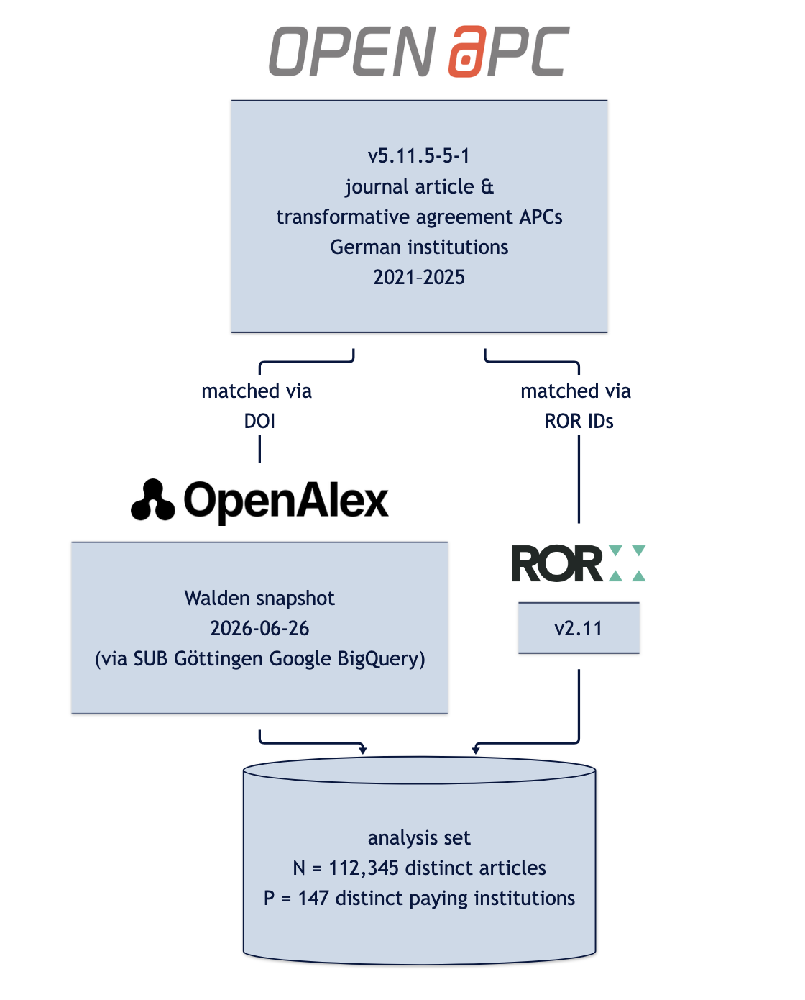

```{r}
#| message: false
#| echo: false
library(tidyverse)
library(here)
library(scales)
library(ggVennDiagram)
options(scipen = 999)
```

```{r}
#| message: false
#| echo: false

article_level <- read_csv(here("APC_link_analysis/data", "article_level.csv"))
rel_shares <- read_csv(here("APC_link_analysis/data", "rel_shares.csv"))
reason <- read_csv(here("APC_link_analysis/data", "reason.csv"))
```

```{=typst}
#align(center)[
  #grid(
    columns: (auto, auto),
    column-gutter: 250pt,
    align: top,

    grid(
      rows: (auto, auto, auto, auto), row-gutter: 14pt,
      align(center)[Sophia Dörner],
      align(center)[#orcid("0000-0001-8747-3422", size: 25pt, color: black)],
      align(center)[Göttingen State and University Library],
      align(center)[sophia.doerner\@sub.uni-goettingen.de],
    ),

    grid(
      rows: (auto, auto, auto, auto), row-gutter: 14pt,
      align(center)[Najko Jahn],
      align(center)[#orcid("0000-0001-5105-1463", size: 25pt, color: black)],
      align(center)[Göttingen State and University Library],
      align(center)[najko.jahn\@sub.uni-goettingen.de],
    ),
  )
]
```

```{=typst}
#v(14pt)
#let col-content = [
```


# Background

Open access publication fees ("APCs") are often invoiced to the institution of the corresponding author. However, corresponding-author data is often unavailable as open research information. Some studies therefore used first author affiliation data as a proxy. This poster tests the policy assumption against payment data collected by the OpenAPC initiative.

# Data

{fig-align="center"}

# How complete is the coverage of OpenAlex corresponding-author data?

OpenAlex is the basis for testing the policy assumption that APCs are invoiced to the correponding author's institution. We determined the share of corresponding-author data for the entire dataset by publication year.

:::: {layout-ncol="2"}

```{=typst}
#align(center)[
  #text(size: 18pt, style: "italic")[
    Figure 1: Share of corresponding-author data
  ]
]
```

```{=typst}
#align(center)[
  #text(size: 18pt, style: "italic")[
    Figure 2: Share of corresponding-author data per publication year
  ]
]
```


```{r}
#| echo: false
#| fig-width: 7
#| fig-height: 6
#| fig-align: center


article_level |>
  count(has_corr) |>
  mutate(share = n / sum(n)) |>
  ggplot(aes(x = has_corr, y = n, fill = has_corr)) +
  geom_col() +
  geom_text(aes(label = percent(share, accuracy = 1)),
    vjust = -0.3, size = 5.5
  ) +
  scale_y_continuous(labels = label_comma(), expand = expansion(mult = c(0, 0.17))) +
  scale_fill_manual(values = c("TRUE" = "#051740", "FALSE" = "#4086e0"), guide = "none") +
  theme_minimal(base_size = 16) +
  labs(x = "has corresponding author", y = "number of articles")
```

```{r}
#| echo: false
#| fig-width: 7
#| fig-height: 6
#| fig-align: center

article_level |>
  count(period, has_corr) |>
  group_by(period) |>
  mutate(share = n / sum(n)) |>
  ungroup() |>
  ggplot(aes(x = factor(period), y = n, fill = has_corr)) +
  geom_col(position = position_dodge2(preserve = "single", width = 0.9)) +
  geom_text(aes(label = percent(share, accuracy = 1)),
    position = position_dodge2(preserve = "single", width = 0.9),
    vjust = -0.3, size = 4.6
  ) +
  scale_y_continuous(labels = label_comma(), expand = expansion(mult = c(0, 0.17))) +
  scale_fill_manual(
    values = c("TRUE" = "#051740", "FALSE" = "#4086e0"),
    labels = c("TRUE" = "TRUE", "FALSE" = "FALSE")
  ) +
  theme_minimal(base_size = 16) +
  labs(x = "publication year", y = "number of articles", fill = "has \ncorresponding")
```

::::

Coverage is high and also proves stable across 2021--2024, but drops in 2025. This might be due to a lag
in OpenAPC data submission and enrichment rather than a change in coverage in OpenAlex.

# How well does ROR-based matching work?

Matching the paying institution's ROR ID to author affiliations works well overall and ROR relationships meaningfully extend what exact ID matching alone would find.

```{r}
#| echo: false
#| output: false

shares <- article_level |>
  summarise(
    n_articles  = n(),
    exact       = sum(exact_any),
    rel         = sum(payer_any & !exact_any),
    none        = sum(!payer_any),
    exact_share = mean(exact_any),
    rel_share   = mean(payer_any & !exact_any),
    none_share  = mean(!payer_any)
  )
```

```{=typst}
#let value_box(value, n, label, color: rgb("#051740")) = {
  box(
    width: 100%,
    stroke: none,
    align(center)[
      #text(size: 32pt, weight: "bold", fill: color)[#value]
      #v(1pt)
      #text(size: 22pt, fill: rgb("#4086e0"))[n = #n]
      #v(4pt)
      #text(size: 22pt, fill: rgb("#444444"))[#label]
    ]
  )
}

#grid(
  columns: (1fr, 1fr, 1fr),
  gutter: 1em,
  value_box("`r scales::percent(shares$exact_share, accuracy = 1)`", "`r format(shares$exact, big.mark = ",")`", "exact ROR match"),
  value_box("`r scales::percent(shares$rel_share, accuracy = 1)`", "`r format(shares$rel, big.mark = ",")`", "only via ROR relationships"),
  value_box("`r scales::percent(shares$none_share, accuracy = 1)`", "`r format(shares$none, big.mark = ",")`", "no match"),
  )
```

Breaking down the 7% matched only via relationships by relationship type shows that most affiliations are matched via the related relationship (`r scales::percent(rel_shares$share_of_articles[4], accuracy = 0.1)`), followed by the child relationship (`r scales::percent(rel_shares$share_of_articles[1], accuracy = 0.1)`). Breaking down the 6% unmatched articles by reason shows that most unmatched cases stem from affiliations either genuinely having no connection to the paying institution or from relationship gaps in ROR.


```{=typst}
#grid(
  columns: (1fr, 1fr, 1fr),
  gutter: 1em,
  value_box("`r scales::percent(reason$share_of_no_match[1], accuracy = 1)`", "`r format(reason$n[1], big.mark = ",")`", "ROR exists, but no direct \n relationship found"),
    value_box("`r scales::percent(reason$share_of_no_match[2], accuracy = 1)`", "`r format(reason$n[2], big.mark = ",")`", "no author affiliation has a ROR ID"),
      value_box("`r scales::percent(reason$share_of_no_match[3], accuracy = 1)`", "`r format(reason$n[3], big.mark = ",")`", "payer ROR record has no \n relationships recorded"),
  )
```


```{=typst}
#align(center)[
  #text(size: 18pt, style: "italic")[
    Figure 3: Example of missing direct relationship between University of Tübingen (paying institution) and University Children's Hospital Tübingen (author affiliation)
  ]

  #v(5pt)

  #let ror-green = rgb("#1a8c73")

  #let ror-link(url, label) = link(url)[#text(fill: ror-green)[#label]]

  #let ror-record(id, name, sections) = {
    align(left)[
      #text(fill: ror-green, size: 16pt)[#link(id)[#id]]
      #v(2pt)
      #text(weight: "bold", size: 16pt)[#name]
      #v(2pt)
      #text(weight: "bold", size: 13pt)[RELATIONSHIPS]
      #v(1pt)
      #for section in sections [
        #text(weight: "bold", size: 12pt)[#section.title] \
        #for item in section.items [
          #text(size: 12pt)[#ror-link(item.url, item.name)] \
        ]
      ]
    ]
  }

  #grid(
    columns: (1fr, 1fr, 1fr),
    column-gutter: 24pt,
    align: top,

    ror-record(
      "https://ror.org/03a1kwz48",
      "University of Tübingen",
      (
        (
          title: "Child Organizations",
          items: (
            (url: "https://ror.org/04zzwzx41", name: "Hertie Institute for Clinical Brain Research"),
            (url: "https://ror.org/00v34f693", name: "Quantitative Biology Center"),
            (url: "https://ror.org/005pfhc08", name: "Senckenberg Centre for Human Evolution and Palaeoenvironment"),
            (url: "https://ror.org/0107nyd78", name: "Tübingen AI Center"),
            (url: "https://ror.org/01kkkw551", name: "Zentrum für Datenverarbeitung"),
          )
        ),
        (
          title: "Related Organizations",
          items: (
            (url: "https://ror.org/02a2sfd38", name: "Klinikum Esslingen"),
            (url: "https://ror.org/00pjgxh97", name: "Universitätsklinikum Tübingen"),
          )
        ),
      )
    ),

    ror-record(
      "https://ror.org/00pjgxh97",
      "Universitätsklinikum Tübingen",
      (
        (
          title: "Child Organizations",
          items: (
            (url: "https://ror.org/04zzwzx41", name: "Hertie Institute for Clinical Brain Research"),
            (url: "https://ror.org/01bavmk12", name: "Poliklinik für Zahnärztliche Prothetik mit Propädeutik"),
            (url: "https://ror.org/02veq1j93", name: "Universitäts Frauenklinik"),
            (url: "https://ror.org/03esvmb28", name: "University Children's Hospital Tübingen"),
          )
        ),
        (
          title: "Related Organizations",
          items: (
            (url: "https://ror.org/03a1kwz48", name: "University of Tübingen"),
            (url: "https://ror.org/05a27za87", name: "ERN-RND"),
          )
        ),
      )
    ),

    ror-record(
      "https://ror.org/03esvmb28",
      "University Children's Hospital Tübingen",
      (
        (
          title: "Parent Organizations",
          items: (
            (url: "https://ror.org/00pjgxh97", name: "Universitätsklinikum Tübingen"),
          )
        ),
      )
    ),
  )
]
```

```{=typst}
#colbreak()
```

# At which author-position is the paying institution recorded as affiliation?

Categorizing the paying institutions by author-position combinations shows they are most often affiliated with the first, last, *and* corresponding author simultaneously.

```{=typst}
#align(center)[
  #text(size: 18pt, style: "italic")[
    Figure 4: Share of articles per author-position category, with and without corresponding-author data
  ]
]
```

```{r}
#| echo: false
#| fig-width: 15
#| fig-height: 9
#| fig-align: center

article_level |>
  count(has_corr, position_category) |>
  group_by(has_corr) |>
  mutate(share = n / sum(n)) |>
  ungroup() |>
  mutate(has_corr = factor(has_corr, levels = c(TRUE, FALSE))) |>
  ggplot(aes(x = share, y = fct_reorder(position_category, share, .fun = max), fill = has_corr)) +
  geom_col() +
  facet_wrap(
    vars(has_corr),
    labeller = as_labeller(c("TRUE" = "has corresponding-author data", "FALSE" = "has no corresponding-author data"))
  ) +
  geom_text(aes(label = percent(share, accuracy = 1)),
    hjust = -0.1, size = 5.5
  ) +
  scale_x_continuous(labels = label_percent(), expand = expansion(mult = c(0, 0.15))) +
  scale_fill_manual(values = c("TRUE" = "#051740", "FALSE" = "#4086e0"), guide = "none") +
  theme_light(base_size = 20) +
  theme(strip.background = element_rect(fill = "#cbd8e8"), strip.text = element_text(colour = "black")) +
  labs(x = "share of articles", y = NULL)
```


Without corresponding-author data, first- and last-author affiliations identify the paying institution for the large majority of articles. For articles with corresponding-author data, corresponding author affiliations show the highest recall for identifying the paying institution.

# Are first and/or last author affiliations a good proxy for identifying the paying institution?

Across all articles, first-, last-, and corresponding-author affiliations identify largely the same set of articles. Using the combination of first- and last-author affiliations captures more additional articles (`r article_level |> summarise( first_last_additional = sum((payer_first | payer_last) & !payer_corr), union_corr_first_last = sum(payer_corr | payer_last | payer_first), gain_pct = first_last_additional / union_corr_first_last) |> pull(gain_pct) |> scales::percent(accuracy = 1)`) than corresponding-author data alone (`r article_level |> summarise(corr_additional = sum(payer_corr & !(payer_first | payer_last)), union_corr_first_last = sum(payer_corr | payer_last | payer_first), gain_pct = corr_additional / union_corr_first_last) |> pull(gain_pct) |> scales::percent(accuracy = 1)`).   

```{r}
#| echo: false
#| output: false

venn_list <- list(
  "Corresponding" = article_level |>
    filter(position_category %in% c(
      "first + last + corresponding", "first + corresponding",
      "last + corresponding", "middle + corresponding"
    )) |>
    pull(doi_norm),
  "First" = article_level |>
    filter(position_category %in% c(
      "first + last + corresponding", "first + corresponding",
      "first + last", "first only"
    )) |>
    pull(doi_norm),
  "Last" = article_level |>
    filter(position_category %in% c(
      "first + last + corresponding", "last + corresponding",
      "first + last", "last only"
    )) |>
    pull(doi_norm)
)
```

```{=typst}
#align(center)[
  #text(size: 18pt, style: "italic")[
    Figure 5: Overlap between articles matched via first, last and corresponding author
  ]
]
```

```{r}
#| echo: false
#| warning: false
#| message: false
#| fig-width: 20
#| fig-height: 14
#| fig-align: center

ggVennDiagram(venn_list, label = "both", set_size = 8, label_size = 8) +
  scale_fill_gradient(low = "#cbd8e8", high = "#051740") +
  theme(legend.position = "none")
```

# Conclusion

- **Coverage:** OpenAlex provides corresponding-author data for the large majority of articles. A comparison with OpenAPC could be a useful approach to verify the accuracy of this data.
- **Matching:** ROR-based matching identifies the paying institution for most articles, ROR relationships extend exact ID matching.
- **Author position:** The paying institution is most often affiliated with the first, last, *and* corresponding author.
- **First/last author as proxy:** First- and last-author affiliations together can serve as a proxy or an additional filter.

# Code Availability

```{=typst}
#grid(
  columns: (3fr, 1fr),
  align: horizon,
  column-gutter: 20pt,
  [The notebook containing the full analysis code behind this poster is openly available on GitHub and can be accessed via the QR code.],
  grid(
    columns: (auto, auto),
    column-gutter: 12pt,
    align: horizon,
    image("images/GitHub_Invertocat_Black.png", width: 50pt),
    box(width: 120pt, height: 120pt)[
      #image("images/qr_code.png", width: 100%)
    ],
  ),
)
```

# About the Project

```{=typst}
#grid(
  columns: (3fr, 10fr, 9fr),
  align: horizon,
  column-gutter: 12pt,
  image("images/logo_oa_datenpraxis.png", width: 100%),
  [The project OA Datenpraxis explores the role of data in the Open Access transformation and supports structural development at research institutions in Germany.],
  grid(
    rows: (auto, auto),
    row-gutter: 6pt,
    align(center)[#image("images/dfg_logo_schriftzug_blau_foerderung_en.jpg", width: 80%)],
    align(center)[528466070],
  ),
)
```


```{=typst}
] // Ende col-content

#context layout(size => {
  let h = measure(columns(2, gutter: 24pt, col-content), width: size.width).height
  place(top + left, dx: size.width / 2, line(angle: 90deg, length: h, stroke: 1pt + blue))
})
#columns(2, gutter: 24pt, col-content)

#v(1fr)

#poster-footer(
  institution-logo: logo-img("images/SUB_logo.png", w: 400pt),   
  conference: [
    #text(fill: navy, size: 22pt, weight: "bold")[
      2026 Conference of the Barcelona Declaration on Open Research Information
    ] \
    #text(fill: navy, size: 20pt)[
      Berlin, 24–25 November 2026
    ]
  ],
  cc-logo: logo-img("images/by.png", w: 150pt),          
)
```
